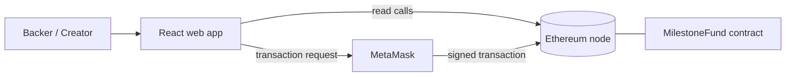
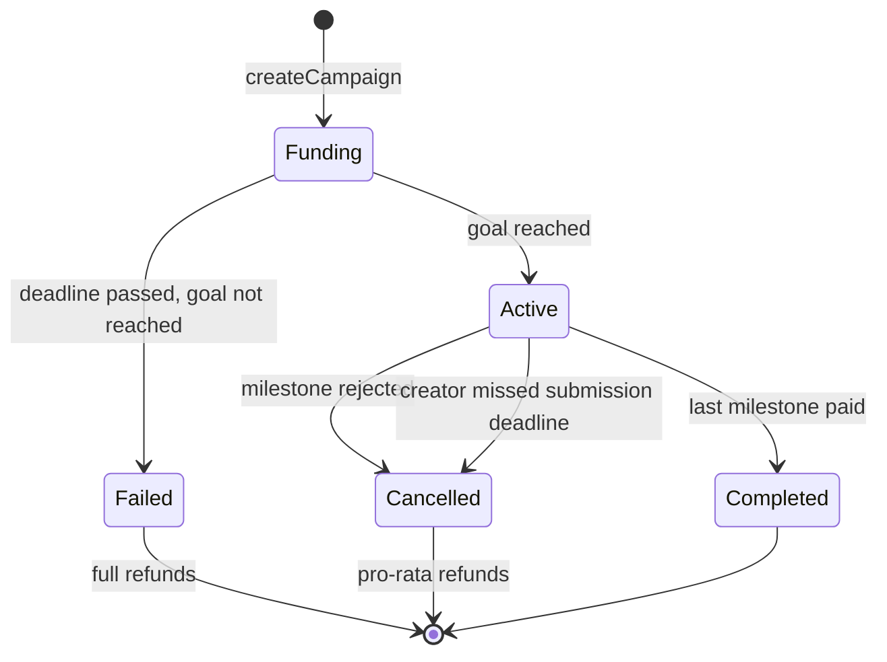
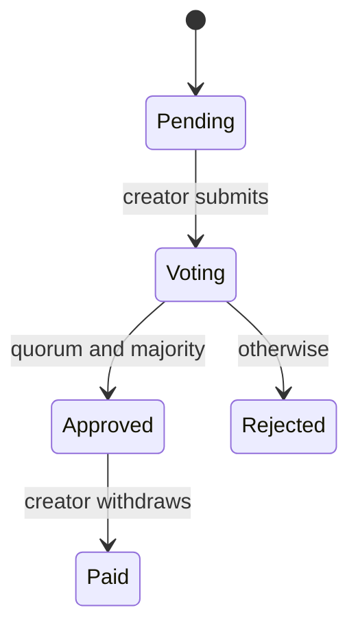

# MilestoneFund: Milestone-Based Crowdfunding with Stake-Weighted Investor Voting

**Course:** Distributed Ledgers / Blockchain — Final Project
**Authors:** Salima Suguralieva, Aliya Suguralieva
**Repository:** https://github.com/suguralievasalima-oss/milestonefund

---

## Abstract

Reward- and equity-based crowdfunding platforms transfer the collected funds to a project creator as soon as the campaign succeeds. Backers then carry the full risk of non-delivery, and recourse is limited to the platform's goodwill or to legal action. We present **MilestoneFund**, a decentralized application (DApp) on Ethereum in which a smart contract escrows the funds and releases them in tranches tied to project milestones. Each tranche is released only after a stake-weighted vote of the backers with a 30% quorum; a rejected milestone cancels the campaign and lets every backer reclaim a pro-rata share of the unreleased funds. The contract also protects backers against a creator who simply stops reporting progress and against a creator who funds the campaign personally in order to approve their own milestones. The system consists of a Solidity contract, a Hardhat-based test and deployment toolchain, and a React web interface integrated with MetaMask. We evaluate it with 47 automated tests (100% line, statement and function coverage), a dedicated reentrancy attack test, and a gas-cost analysis of every state-changing operation.

---

## 1. Introduction

Crowdfunding has become a common way to finance early-stage hardware, software and creative projects. On centralized platforms such as Kickstarter and Indiegogo, money pledged by backers is transferred to the creator once the funding goal is reached. From that point on, backers depend entirely on the creator's honesty and competence. Failed or abandoned projects are a well-known problem, and backers typically have no mechanism to stop further spending or to recover the unspent part of their contribution.

Blockchains allow this trust assumption to be replaced with code. A smart contract can hold funds, enforce rules that no single party can change, and execute payouts automatically. The goal of this project is to design, implement and evaluate a crowdfunding protocol in which:

1. funds are held by a smart contract rather than by the creator or a platform operator;
2. a project is split into milestones, and money is released milestone by milestone;
3. backers decide, through a vote weighted by their contribution, whether each milestone has been delivered;
4. if backers reject a milestone, the remaining funds are returned to them automatically and proportionally;
5. a creator cannot block the process by never submitting a milestone, nor approve their own milestones by contributing to their own campaign.

**Contributions.** (i) A single Solidity contract that manages an unbounded number of independent campaigns with an explicit state machine; (ii) a voting scheme with stake-weighted votes, a quorum computed over outside investors only, and frozen vote weights; (iii) a submission deadline that prevents funds from being locked forever; (iv) a web interface that exposes only the actions allowed in the current state; (v) a quantitative evaluation through automated tests, coverage, a security analysis and gas measurements.

---

## 2. Background and Related Work

| Platform | Custody of funds | Release model | Backer recourse |
|---|---|---|---|
| Kickstarter / Indiegogo | Platform, then creator | All at once after a successful campaign | None built-in |
| Gitcoin Grants | Smart contracts / matching pools | Donations and quadratic-funding matches paid to grantees | None: donations are final |
| Juicebox | Project treasury contract | Programmable funding cycles defined by the project owner | Redemption against treasury, rules set by the owner |
| Giveth | Donations sent to project wallets | Direct donations | None |
| **MilestoneFund** | **Escrow contract** | **Per milestone, after a stake-weighted vote** | **Automatic pro-rata refund of unreleased funds** |

Existing on-chain funding tools focus mostly on donations and grants, where backers do not expect a deliverable, or give the project owner control over payout rules. MilestoneFund targets the opposite case: backers who expect delivery and want enforceable control over the release of their money. The idea of releasing funds in stages under backer control is related to DAO treasury governance, but here governance is scoped to a single campaign, voting rights are derived directly from contributions, and the only decisions are "approve this milestone" or "reject it and refund".

---

## 3. System Design

### 3.1 Architecture



* **Smart contract** (`MilestoneFund.sol`) holds all funds and all rules. It is the only trusted component.
* **Ethereum node** — a local Hardhat network during development and demonstration; the same contract can be deployed to the Sepolia test network.
* **Web application** (React + ethers.js) reads state directly from the node and sends state-changing transactions through MetaMask, which holds the user's private key and asks for confirmation.

The interface has no privileged role: every action available in the UI can also be performed by calling the contract directly.

### 3.2 Campaign life cycle



Each milestone has its own status:



### 3.3 Rules

**Creating a campaign.** The creator specifies a title, a funding goal, a funding duration and 1–10 milestones. The sum of milestone amounts must equal the goal.

**Funding.** Anyone can contribute while the campaign is in the *Funding* state and before its deadline. Funding is finalized by anyone: as soon as the goal is reached, or after the deadline. Contributions are impossible after finalization, so **vote weights are frozen before any vote takes place**.

**Voting.** For the current milestone the creator opens a vote of fixed length (`votingPeriod`). Each backer may vote once, with weight equal to their contribution. The creator may not vote. After the vote ends, anyone can finalize it. The milestone is approved if and only if

* turnout ≥ 30% of the *voting stake*, where voting stake = total raised − creator's own contribution, and
* weight "yes" > weight "no" (a tie is a rejection).

**Payout.** The creator withdraws the amount of an approved milestone. If the campaign was over-funded, the surplus is paid together with the last milestone.

**Refunds.**
* *Failed* campaign: each backer reclaims their full contribution.
* *Cancelled* campaign: each backer reclaims `contribution × (totalRaised − released) / totalRaised`, i.e. a pro-rata share of everything not yet paid to the creator.

**Submission deadline.** After funding is finalized and after every paid milestone, the creator has `submissionPeriod` to open the next vote. If the deadline passes with the milestone still pending, anyone can call `cancelStalled`, which cancels the campaign and opens pro-rata refunds. Without this rule, a creator could collect the first tranche and simply stop, leaving the remaining funds locked in the contract forever.

### 3.4 Worked example

A campaign with a goal of 10 ETH and milestones of 3 + 3 + 4 ETH is funded by A (5 ETH), B (3 ETH) and C (2 ETH).

1. Milestone 1: A and B approve (80% turnout, 8 vs 0) → approved → creator receives 3 ETH.
2. Milestone 2: A and B reject, C approves → rejected → campaign cancelled.
3. Remaining 7 ETH are refunded as 3.5 / 2.1 / 1.4 ETH to A / B / C.

If only C had voted on milestone 1, turnout would have been 20% < 30% and the milestone would have been rejected even though all votes were "yes".

---

## 4. Implementation

| Component | Technology |
|---|---|
| Smart contract | Solidity 0.8.24, OpenZeppelin Contracts 5 (`ReentrancyGuard`) |
| Development, testing, deployment | Hardhat 2, Mocha/Chai, hardhat-network-helpers, solidity-coverage, hardhat-gas-reporter |
| Web interface | React 18, Vite 5, ethers.js 6, MetaMask |
| Networks | Hardhat local network (chain ID 31337); Sepolia supported through configuration |

**Contract structure.** One contract stores all campaigns in an array; milestones, contributions, votes and refund flags live in nested mappings keyed by campaign ID. This avoids deploying one contract per campaign (deployment costs about 2.09 M gas) and keeps campaigns isolated from each other.

**Main functions.**

| Function | Caller | Effect |
|---|---|---|
| `createCampaign` | anyone | creates a campaign with its milestones |
| `contribute` | anyone | adds ETH during funding |
| `finalizeFunding` | anyone | *Funding* → *Active* or *Failed* |
| `startMilestoneVote` | creator | opens the vote on the current milestone |
| `vote` | backers (not the creator) | stake-weighted yes/no, once per milestone |
| `finalizeMilestone` | anyone | applies quorum and majority rules |
| `withdrawMilestone` | creator | pays an approved milestone |
| `cancelStalled` | anyone | cancels a campaign whose creator missed the submission deadline |
| `refund` | backers | full or pro-rata refund |

**Design decisions.**
* *Pull payments.* The contract never loops over backers to send refunds; each backer withdraws their own refund. This keeps gas per call constant and prevents one failing recipient from blocking everyone else.
* *Custom errors* (`error NotCreator()` etc.) instead of revert strings — cheaper and easy to decode in the UI.
* *Configurable time parameters.* `votingPeriod` and `submissionPeriod` are constructor arguments: 5 minutes and 1 hour for the local demonstration, 3 days and 30 days by default on public networks.
* *Events* for every state change, so the interface and external indexers can follow the campaign history.

**Web interface.** The application lists all campaigns with progress bars, lets users create campaigns with a dynamic milestone form (validated so that milestone amounts sum to the goal), and shows a detail page per campaign. On the detail page only the actions permitted for the current account and state are displayed: "Start milestone vote" and "Withdraw" for the creator, "Approve"/"Reject" for backers, "Finalize" when a deadline has passed, "Refund" with the exact refundable amount, and "Cancel stalled campaign" when the creator has missed the deadline. Contract errors are decoded into readable messages.

**Tooling.** Scripts deploy the contract and export its address and ABI to the front end (`deploy.js`), seed demonstration campaigns (`seed.js`), advance blockchain time on the local network (`advance-time.js`), and run individual demonstration steps from the command line (`demo.js`).

---

## 5. Evaluation

### 5.1 Functional testing

The test suite contains **47 automated tests, all passing**.

| Group | Tests | What is verified |
|---|---|---|
| Deployment | 2 | parameters stored; zero periods rejected |
| Campaign creation | 7 | valid creation; invalid sums, array lengths, 0 or >10 milestones, zero goal/duration, unknown ID |
| Contributions | 4 | accounting and events; after deadline; zero value; after finalization |
| Funding finalization | 3 | *Active* when goal reached; *Failed* after deadline; no early failure |
| Voting | 10 | only creator opens; no double opening; outsiders, double votes, late votes rejected; weight = contribution; tie rejected |
| Creator stake | 3 | creator cannot vote; quorum over outside stake; outside investors decide even when the creator funded 60% |
| Stalled campaigns | 4 | no early cancellation; cancellation and full refund after deadline; no cancellation during a vote; deadline restarts after each payout |
| Quorum | 2 | 20% turnout rejected; exactly 30% approved |
| Withdrawals | 5 | only after approval; only creator; full happy path over three milestones; over-funding; no double withdrawal |
| Refunds | 5 | full refund after failure; 3.5/2.1/1.4 ETH pro-rata refund; no double refund; no refund while active; outsiders |
| Security | 2 | reentrancy attack blocked; campaigns isolated |

### 5.2 Coverage

| File | Statements | Branches | Functions | Lines |
|---|---|---|---|---|
| `MilestoneFund.sol` | 100% | 83.6% | 100% | 100% |

All statements and functions of the contract are executed by the tests. The uncovered branches are mostly the second operand of combined conditions and the failure branch of the ETH transfer, which cannot be triggered by an honest recipient.

### 5.3 Gas cost

Measured with `hardhat-gas-reporter` (Solidity optimizer enabled, 200 runs). The cost columns assume a gas price of 20 gwei and an illustrative ETH price of 3,000 USD; actual costs scale linearly with both.

| Operation | Avg. gas | ETH @ 20 gwei | ≈ USD |
|---|---|---|---|
| Deploy contract (once) | 2,089,534 | 0.0418 | 125.4 |
| `createCampaign` (2–3 milestones) | 279,408 | 0.0056 | 16.8 |
| `contribute` | 65,932 | 0.0013 | 4.0 |
| `finalizeFunding` | 36,656 | 0.0007 | 2.2 |
| `startMilestoneVote` | 75,340 | 0.0015 | 4.5 |
| `vote` | 79,688 | 0.0016 | 4.8 |
| `finalizeMilestone` | 48,839 | 0.0010 | 2.9 |
| `withdrawMilestone` | 65,772 | 0.0013 | 3.9 |
| `refund` | 65,521 | 0.0013 | 3.9 |
| `cancelStalled` | 33,458 | 0.0007 | 2.0 |

**Full campaign.** A campaign with three backers and three milestones, each approved by two votes, costs about 1.56 M gas in total (≈ 0.031 ETH, ≈ 94 USD at the assumptions above), spread across all participants. Per backer, participation costs one contribution plus one vote per milestone — roughly 5–20 USD on Ethereum mainnet. On a rollup (e.g. Arbitrum, Optimism, Base), where fees are typically one to two orders of magnitude lower, the same actions cost cents, which makes the design practical for small campaigns.

All functions have constant gas cost: there are no loops over backers, and the only loop (over milestones in `createCampaign`) is bounded by 10.

---

## 6. Security Analysis

| Threat | Mitigation | Evidence |
|---|---|---|
| **Reentrancy** — a malicious recipient re-enters `refund` or `withdrawMilestone` during the ETH transfer | `nonReentrant` modifier; checks-effects-interactions (state updated before the transfer) | Test with `Attacker.sol`: the re-entry fails, the attacker receives only its own contribution, other funds stay in the contract |
| **Vote buying before a vote** — contributing just before voting to swing the result | Contributions only in *Funding*; votes only in *Active* | Test: contribution after finalization reverts |
| **Creator self-approval** — creator funds the campaign to control the vote | Creator cannot vote; quorum computed over outside stake only | "Creator stake" tests |
| **Abandoned campaign** — creator takes the first tranche and disappears | `submissionPeriod` + `cancelStalled` callable by anyone | "Stalled campaigns" tests |
| **Unauthorized actions** | Role checks (`NotCreator`, `NotInvestor`, `AlreadyVoted`) and explicit state checks on every function | Voting and withdrawal tests |
| **Double spending of refunds/payouts** | `refunded` flag per backer; milestone status `Paid` | "cannot refund twice", "cannot withdraw twice" |
| **Integer overflow** | Solidity ≥ 0.8 checked arithmetic | — |
| **Denial of service by gas** | No unbounded loops; pull payments | Gas table: constant per-call costs |
| **Stuck finalization** | `finalizeFunding`, `finalizeMilestone`, `cancelStalled` callable by anyone | — |

**Residual risks.**
* *Whale dominance.* A backer holding more than half of the outside stake decides every vote alone. This is inherent in stake weighting; Section 7 lists alternatives.
* *Sybil creator.* A creator could fund the campaign from a second address that is not recognized as the creator. Stake weighting limits the damage — the creator must lock real funds that are refundable to others on rejection — but cannot fully prevent it without identity.
* *Subjective judgement.* The contract cannot check that a milestone was actually delivered; it relies on backers' judgement.
* *Rounding.* Integer division in pro-rata refunds can leave a few wei in the contract.
* *Timestamp dependence.* Deadlines use `block.timestamp`, which validators can shift by seconds — negligible relative to periods of minutes or days.

---

## 7. Limitations and Future Work

* **Alternative voting rules** — quadratic voting or a per-backer weight cap to reduce whale dominance.
* **ERC-20 support** — accept stablecoins (e.g. USDC) so that the campaign goal is not exposed to ETH price volatility.
* **Evidence of delivery** — attach IPFS links to milestone submissions so backers can review deliverables on-chain.
* **Partial approval and re-submission** — allow a rejected milestone to be resubmitted once before cancelling the campaign.
* **Vote delegation** — let passive backers delegate their vote.
* **Layer-2 deployment** — deploy to a rollup to reduce costs for small backers.
* **Front-end indexing** — use events and an indexer (e.g. The Graph) instead of polling for large numbers of campaigns.

---

## 8. Conclusion

MilestoneFund replaces the trust that backers place in a crowdfunding creator with an escrow smart contract and a simple governance process. Funds are released only for milestones approved by a stake-weighted vote with a quorum; rejected or abandoned projects automatically return the unreleased funds to backers in proportion to their contributions. Extensive automated testing (47 tests, 100% line coverage), a reentrancy attack test and a gas analysis show that the protocol behaves as specified and that its costs are moderate on Ethereum mainnet and low on layer-2 networks. The main open problems — concentration of voting power and objective verification of milestone delivery — are shared by most on-chain governance systems and are natural directions for further work.

---

## References

1. Ethereum Foundation. *Ethereum Whitepaper* and developer documentation. https://ethereum.org/en/developers/docs/
2. Solidity documentation, version 0.8.24. https://docs.soliditylang.org/
3. OpenZeppelin Contracts 5 — `ReentrancyGuard`. https://docs.openzeppelin.com/contracts/5.x/
4. Hardhat documentation. https://hardhat.org/docs
5. ethers.js v6 documentation. https://docs.ethers.org/v6/
6. Solidity documentation — Security considerations: Use the Checks-Effects-Interactions pattern. https://docs.soliditylang.org/en/latest/security-considerations.html
7. Kickstarter — Trust and Safety / Accountability. https://www.kickstarter.com/help
8. Gitcoin Grants. https://www.gitcoin.co/
9. Juicebox Protocol documentation. https://docs.juicebox.money/
10. V. Buterin, Z. Hitzig, E. G. Weyl. *A Flexible Design for Funding Public Goods.* Management Science, 2019.

---

## Appendix A. Reproducing the results

```powershell
npm install
npx hardhat test                          # 47 tests
npx hardhat coverage                      # coverage table
$env:REPORT_GAS="true"; npx hardhat test  # gas table
```

Raw outputs are stored in `docs/test-results.txt`, `docs/coverage.txt` and `docs/gas-report.txt`.

## Appendix B. Division of work

| Member | Responsibilities |
|---|---|
| Salima Suguralieva | Smart contract design and implementation, test suite, security analysis, deployment scripts |
| Aliya Suguralieva | Web interface, demonstration scenario, gas and cost analysis, report, presentation |
